# Tugas 4: Aplikasi Manajemen Produk dengan React Router dan Tailwind CSS

Proyek pengembangan aplikasi Manajemen Produk menggunakan React, React Router v7, dan Tailwind CSS v4 dengan arsitektur Atomic Design, navigasi berbasis Single-Page Application (SPA), serta persistensi data state terpusat di peramban web.

Dikembangkan untuk memenuhi penugasan praktikum mata kuliah Pemrograman Web (Pertemuan 13), Departemen Teknologi Informasi, Fakultas Teknologi Elektro dan Informatika Cerdas, Institut Teknologi Sepuluh Nopember (ITS).

## 1. Daftar Rute Aplikasi

Aplikasi dibangun menggunakan pola navigasi deklaratif React Router v7 dengan nested routes di bawah layout bersama (AppLayout):

| Rute URL | Komponen Halaman | Deskripsi dan Perilaku Navigasi |
|---|---|---|
| / | DashboardPage | Tampilan beranda ringkasan inventaris: Total Produk Terdaftar, Total Unit Stok Fisik, Estimasi Total Nilai Aset, Rata-rata Harga, Distribusi Kategori, dan Peringatan Stok Menipis (stok <= 5 unit). |
| /products | ProductsPage | Katalog produk interaktif lengkap dengan operasi CRUD (Tambah, Lihat, Edit, Hapus), pencarian instan nama/SKU/deskripsi, filter kategori, pengurutan harga/stok/nama, serta mode tampilan Grid atau List. |
| /products/:id | ProductDetailPage | Halaman detail produk dinamis memanfaatkan parameter URL useParams(). Jika ID tidak ditemukan (misal /products/999), menampilkan pesan ramah Produk Tidak Ditemukan dan tombol pemulihan. |
| /settings | SettingsPage | Halaman preferensi tampilan produk (Grid View vs List View) yang tersinkronisasi ke katalog, status payload data di memori localStorage, dan opsi reset ke data seeder awal. |
| * | NotFoundPage | Wildcard fallback route untuk menangani seluruh URL yang tidak terdaftar dengan visual error 404 dan tautan navigasi pemulihan menuju Dashboard atau Produk. |

## 2. Cara Menjalankan Proyek

### Persyaratan Sistem
* Node.js: Versi 18 ke atas (Direkomendasikan Node.js v20+)
* npm: Versi 9 ke atas

### Langkah Instalasi dan Menjalankan Server
1. Clone repositori ke komputer lokal Anda:
   ```bash
   git clone https://github.com/keisyaahm/pweb-class-react-tailwind-task.git
   cd pweb-class-react-tailwind-task
   ```

2. Pastikan berada di branch pengerjaan tugas-4:
   ```bash
   git checkout tugas-4
   ```

3. Pasang seluruh dependensi proyek:
   ```bash
   npm install
   ```

4. Jalankan development server berbasis Vite:
   ```bash
   npm run dev
   ```
   Buka peramban di alamat http://localhost:5173.

5. Melakukan kompilasi build untuk produksi (opsional):
   ```bash
   npm run build
   npm run preview
   ```

## 3. Lokasi State Bersama dan Mekanisme Persistensi

* Lokasi State Terpusat: State utama dikelola pada komponen root src/App.jsx di atas tingkatan Routes dan diteruskan ke child routes.
* State yang Dikelola:
  1. products: Array daftar produk (mendukung penambahan baru, pengubahan data harga/stok/deskripsi, dan penghapusan).
  2. displayMode: String "grid" atau "list" untuk mengatur format visualisasi kartu atau tabel di katalog produk.
* Mekanisme Persistensi dan Lifecycle SPA:
  * Seluruh mutasi state disinkronkan secara otomatis ke localStorage peramban melalui key pweb_products_data_v1 dan pweb_products_settings_v1.
  * Saat berpindah antarhalaman melalui komponen Link atau NavLink, aplikasi tidak melakukan full page reload (SPA behavior), sehingga state tetap utuh di siklus memori React.
  * Saat halaman dimuat ulang langsung melalui address bar atau tombol refresh (F5), aplikasi membaca dan memulihkan data dari localStorage.
  * Disediakan tombol Reset ke Data Seeder Awal di halaman /settings untuk mengembalikan inventaris ke seed awal (initialProducts.js).

## 4. Pembagian Komponen (Atomic Design)

Struktur kode proyek dirancang rapi mengikuti prinsip metodologi Atomic Design:

* src/components/atoms/
  * Badge.jsx: Komponen label status stok dan kategori dengan variasi warna
  * Button.jsx: Komponen tombol fleksibel (varian: primary, secondary, neutral, danger, ghost)
  * Input.jsx: Elemen input form terstandarisasi dengan penanganan fokus dan status error
* src/components/molecules/
  * FormField.jsx: Pembungkus label, elemen kontrol input, dan pesan validasi error
  * ProductCard.jsx: Kartu informasi produk (nama, SKU, harga Rp, stok, aksi detail/edit/hapus)
  * StatCard.jsx: Kartu ringkasan metrik statistik inventaris untuk Dashboard
* src/components/organisms/
  * ConfirmModal.jsx: Dialog modal konfirmasi untuk tindakan destruktif (hapus produk/reset data)
  * Navbar.jsx: Navigasi utama dengan NavLink aktif, counter badge, dan mobile menu
  * ProductGrid.jsx: Wadah tampilan kartu produk dengan grid responsif (1, 2, hingga 3 kolom)
  * ProductList.jsx: Wadah tampilan tabel daftar data produk dalam format list
  * ProductModal.jsx: Pop-up form modal untuk tambah dan edit produk dengan validasi input ketat
* src/data/
  * initialProducts.js: Data seeder awal produk, kategori, key storage, dan helper format Rupiah
* src/layouts/
  * AppLayout.jsx: Template layout bersama yang memuat Navbar, wadah Outlet, dan footer
* src/pages/
  * DashboardPage.jsx: Halaman statistik, distribusi kategori, dan peringatan stok menipis
  * NotFoundPage.jsx: Halaman 404 penanganan rute wildcard (*) dengan tombol pemulihan
  * ProductDetailPage.jsx: Halaman spesifikasi detail produk berbasis ID dinamis (:id) via useParams()
  * ProductsPage.jsx: Halaman katalog produk dengan pencarian, filter kategori, dan modal CRUD
  * SettingsPage.jsx: Halaman preferensi tampilan (grid/list) dan manajemen penyimpanan data
* src/App.jsx: Entry router utama, pengelola state terpusat, dan sinkronisasi localStorage
* src/index.css: Entry styling utama dengan integrasi Tailwind CSS v4
* src/main.jsx: Titik masuk aplikasi React dengan pembungkus BrowserRouter

## 5. Bukti dan Skenario Pengujian

Pengujian dilakukan secara menyeluruh terhadap seluruh fitur routing, manipulasi state, responsivitas tampilan, dan aksesibilitas:

| No | Skenario Pengujian | Langkah Pengujian | Hasil yang Diharapkan | Hasil Aktual | Bukti Tangkapan Layar |
|:--:|---|---|---|:---:|:---:|
| 1 | Membuka Dashboard (/) | Buka URL / | Menampilkan ringkasan inventaris: Total Produk, Total Unit Stok, Estimasi Nilai Aset, Rata-rata Harga, Distribusi Kategori, dan Alert Stok Menipis. | Sesuai | 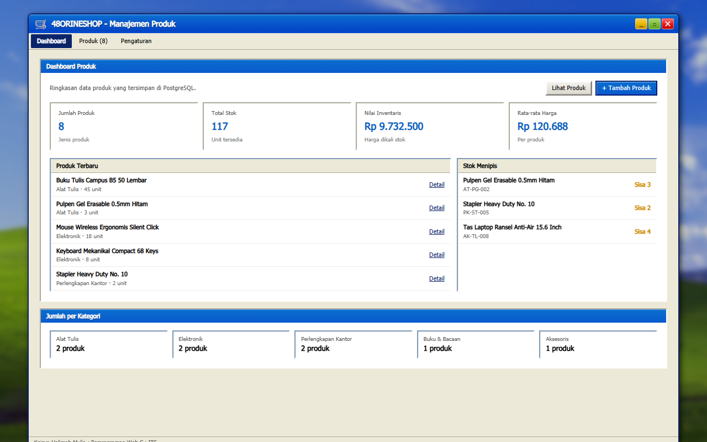 |
| 2 | Katalog Produk Tampilan Grid (/products) | Klik menu Produk pada Navbar dalam mode grid | Menampilkan kartu katalog produk dalam layout responsif lengkap dengan label status stok dan harga terformat Rupiah. | Sesuai | 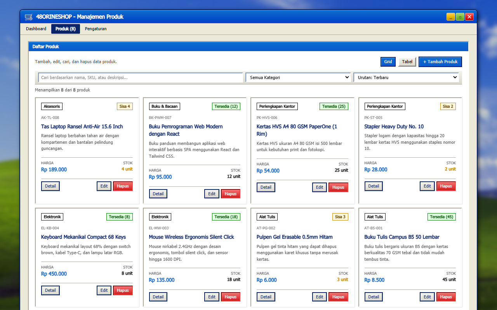 |
| 3 | Katalog Produk Tampilan List/Tabel | Klik ikon List Mode pada toggle tampilan | Format tampilan produk beralih menjadi tabel kompak dengan rincian SKU, Kategori, Harga, Stok, dan tombol aksi. | Sesuai | 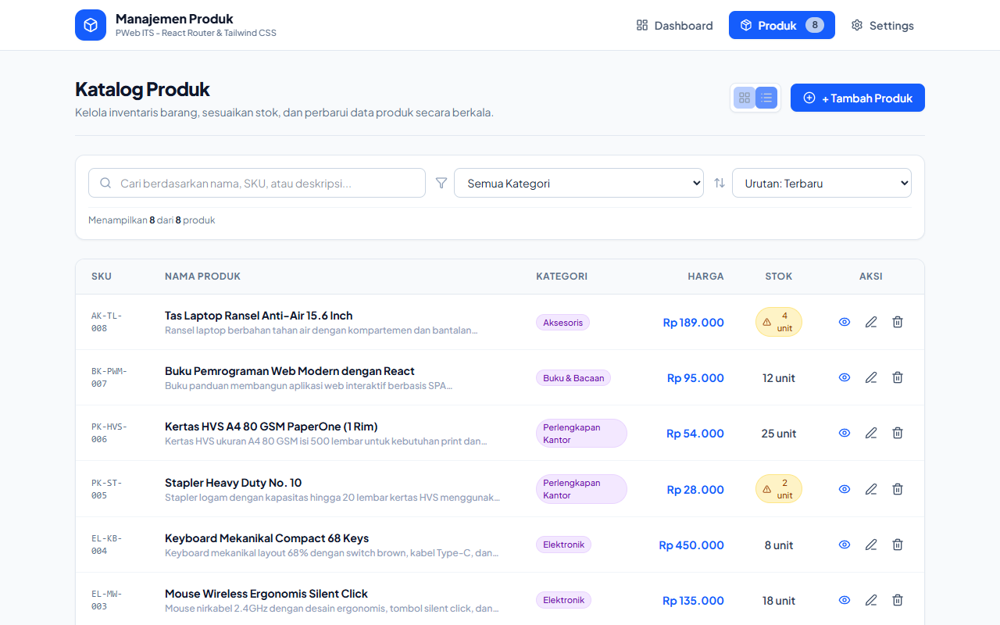 |
| 4 | Pencarian dan Filter Kategori | Ketik kata kunci "pulpen" pada kolom pencarian | Daftar produk langsung terfilter secara instan hanya menampilkan item yang sesuai dengan kata kunci. | Sesuai | 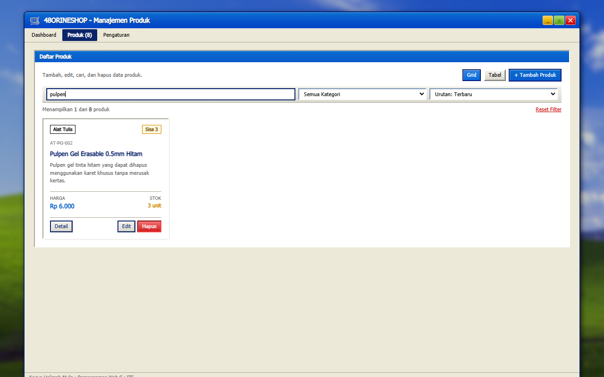 |
| 5 | Validasi Form Tambah Produk | Buka modal Tambah Produk, lalu tekan tombol Tambah dalam kondisi form kosong | Form memvalidasi input dan menampilkan pesan peringatan error merah di bawah setiap field yang wajib diisi. | Sesuai | 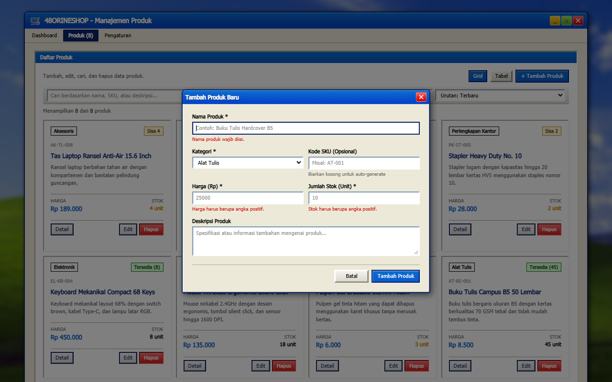 |
| 6 | Tambah Produk Baru Berhasil | Isi form dengan data valid, lalu klik tombol submit | Produk baru berhasil ditambahkan ke dalam state dan localStorage, serta langsung muncul di urutan teratas katalog. | Sesuai | 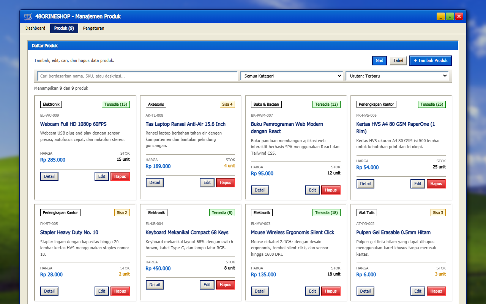 |
| 7 | Edit Data Produk | Klik tombol Edit pada salah satu produk | Modal edit menampilkan data produk yang ada; perubahan harga/stok langsung terupdate secara real-time. | Sesuai | 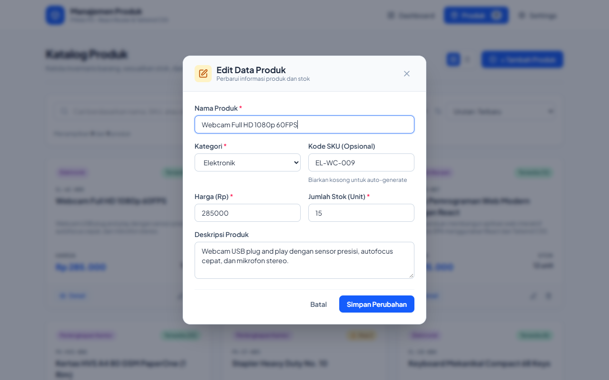 |
| 8 | Konfirmasi Hapus Produk | Klik tombol Hapus pada salah satu kartu produk | Menampilkan modal dialog konfirmasi peringatan sebelum data benar-benar dihapus dari sistem inventaris. | Sesuai | 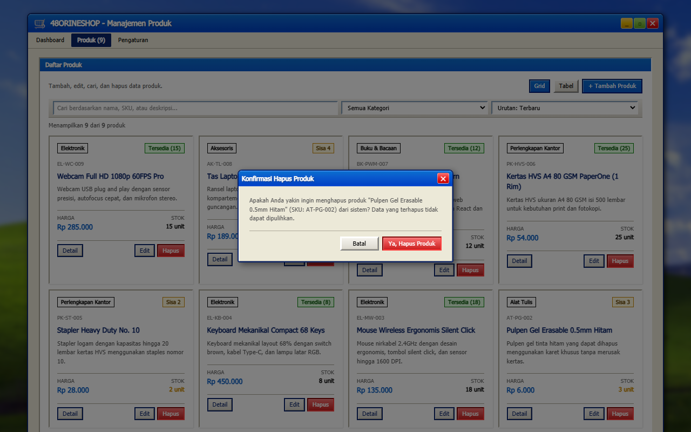 |
| 9 | Detail Produk Berdasarkan ID (/products/:id) | Klik tombol Detail pada salah satu produk | Mengarahkan ke rute dinamis /products/:id dan merender data spesifik produk menggunakan hook useParams(). | Sesuai | 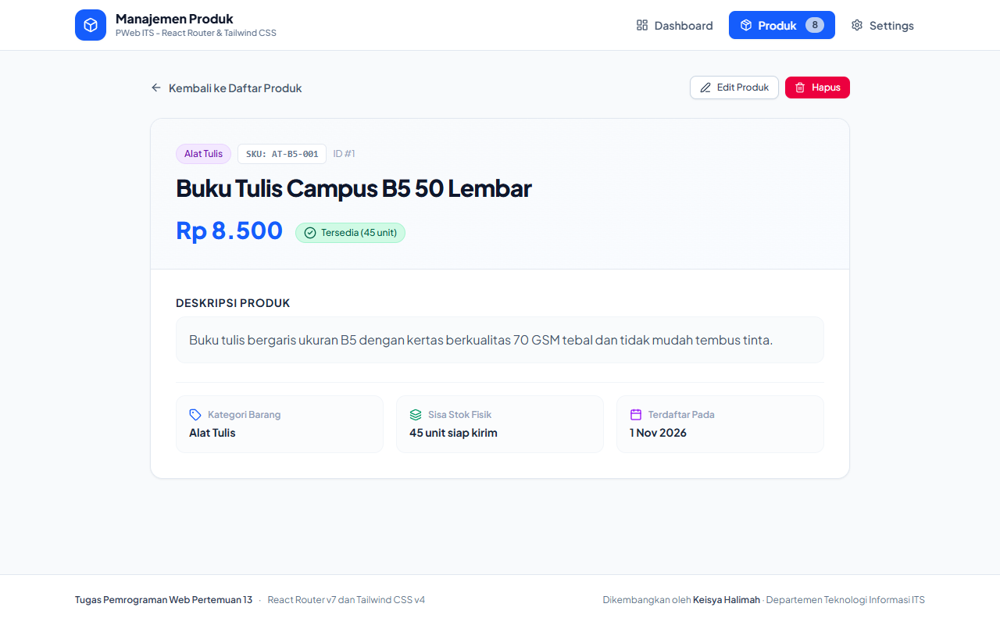 |
| 10 | Akses Produk Tidak Ada (/products/999) | Masukkan URL ID produk acak /products/999 | Menampilkan pesan informatif Produk Tidak Ditemukan dan menyediakan tombol navigasi kembali ke katalog produk. | Sesuai | 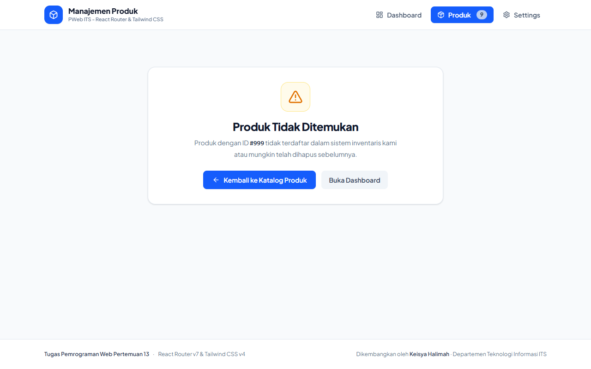 |
| 11 | Penanganan URL Tak Dikenal (*) | Masukkan alamat URL acak seperti /halaman-salah | Wildcard route * menangkap URL dan menampilkan halaman 404 NotFoundPage dengan tombol kembali ke Beranda. | Sesuai | 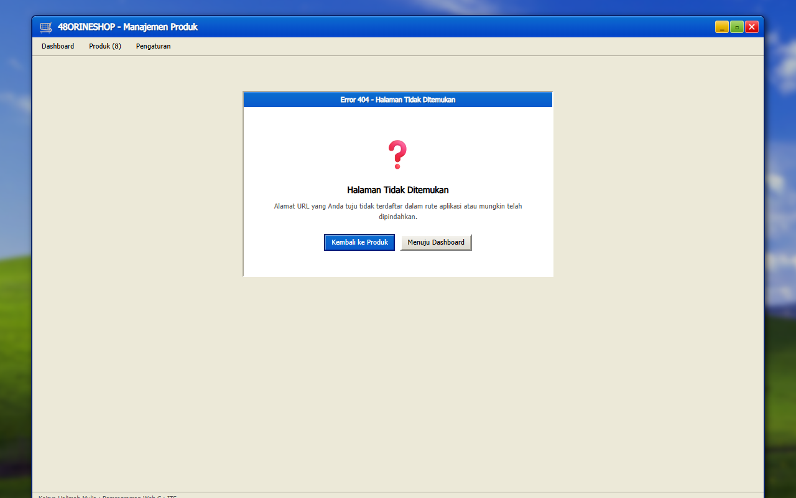 |
| 12 | Pengaturan Preferensi Tampilan (/settings) | Buka halaman /settings, ubah preferensi ke Mode Tabel | Preferensi tersimpan di localStorage dan secara otomatis diterapkan saat membuka kembali halaman /products. | Sesuai | 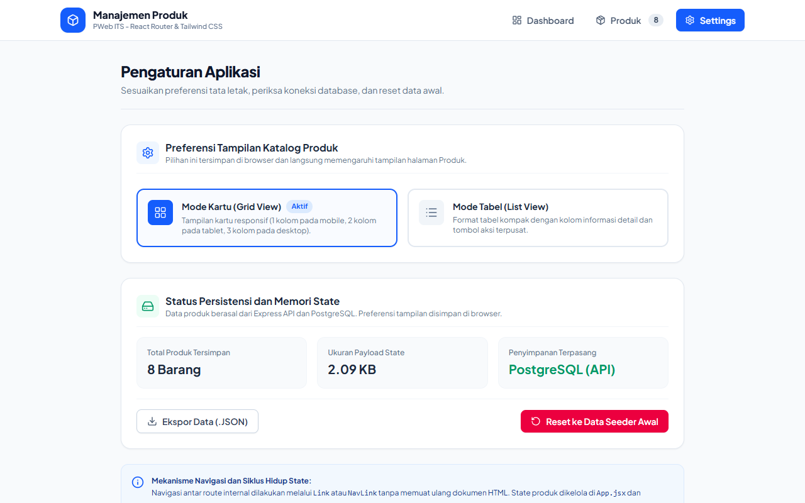 |
| 13 | Responsivitas Layar (Mobile Viewport) | Buka aplikasi pada viewport layar mobile (375 x 667 px) | Layout beradaptasi secara optimal dengan grid 1 kolom dan navbar responsif mobile-friendly. | Sesuai | 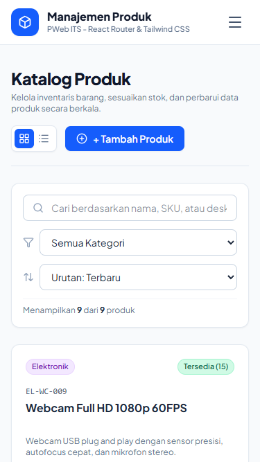 |
| 14 | Aksesibilitas Keyboard (Escape Key) | Buka modal tambah/edit produk, lalu tekan tombol Escape pada keyboard | Modal pop-up dialog tertutup secara otomatis tanpa memerlukan klik mouse (memenuhi standar aksesibilitas). | Sesuai | 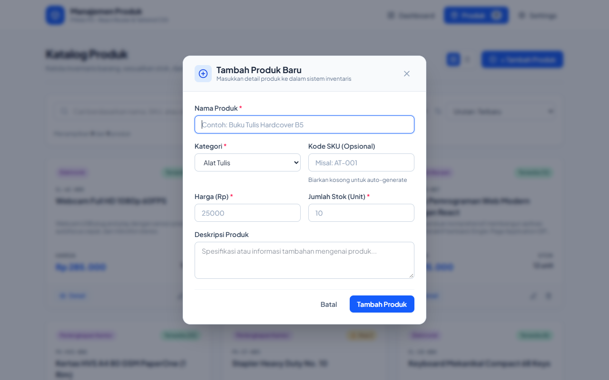 |

## 6. Identitas Pengembang
* Nama: Keisya Halimah
* Departemen: Teknologi Informasi
* Fakultas: Fakultas Teknologi Elektro dan Informatika Cerdas (FTEIC)
* Institusi: Institut Teknologi Sepuluh Nopember (ITS)
* Mata Kuliah: Pemrograman Web (Pertemuan 13 - React Router dan Tailwind CSS)
